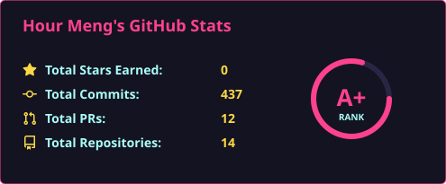

# Hi, I'm Hour Meng 

**🎮 Roblox Developer &nbsp;·&nbsp; 💻 Second-year Software Engineering student &nbsp;·&nbsp; 🛸 Phnom Penh, Cambodia**

<i>⚡️ vincit qui se vincit ⚡️</i>

---

## 👨‍💻 About me

I'm a **second-year Software Engineering student at Kirirom Institute of Technology (KIT)** in Cambodia, and I build games on **Roblox** with **Luau**. I run **Eggcellent Studio**, my Roblox group and studio, along with its Discord community.

- 🚀 Passionate about software engineering, system architecture, and automation
- 🏆 Always learning, competing in hackathons, and meeting other builders
- 🧠 Big on self-improvement and self-mastery.
- 🏍️ Big fan of cruiser motorcycles (Harley-Davidson, Indian Motorcycle)

## 🎮 My Roblox journey

| Stage | What it looked like |
| :-- | :-- |
| 🌱 **Getting started** | Learned Roblox Studio and Luau from scratch: scripting basics, events, and small experiments |
| 🧱 **Leveling up** | Moved to **object-oriented, modular code** with isolated, fault-tolerant base classes so one broken system can't take down the rest |
| 🔧 **Working like a studio** | Switched to **Rojo + Git/GitHub** for version control, with written specs and code reviews before anything ships |
| 🚢 **Shipping real systems** | Building multi-system games: **DataStore saving and data migrations**, **monetization** (developer products, game passes, gifting), **UI/UX**, **VFX**, plus lighting and sound polish |
| 🤖 **AI-assisted development** | Running a modern pipeline: **OpenAI Codex** as the builder, **Gemini** for specs and code review, and an asset pipeline with **Cloudflare Flux** concept art and **Blender**. I stay in charge of the design, testing, and final calls |
| 🎯 **Next** | Keep growing as a game developer and go deeper into game development in my studies |

## 🛠️ Tech stack

**Game development**

  
  
  
  

**AI-assisted workflow**

  
  
  

**Languages and tools**

  
  
  
  
  
  
  
  
  
  
  
  

## 🌱 Currently

- 🎮 Building and polishing a multi-system Roblox game with **Eggcellent Studio**
- 🧩 Sharpening clean OOP architecture, safe data saving, and monetization in Luau
- ✨ Leveling up UI/UX and VFX so games feel good to play
- 🥀 Still learning **Angular** and modern frontend frameworks

## 📊 GitHub stats

  

## 🎧 On repeat

  

---

💬 Want to connect? Let's chat on <a href="https://t.me/EangHourMeng">Telegram (@EangHourMeng)</a>

Made with ❤️ in Phnom Penh, Cambodia &nbsp;·&nbsp; ⚡️ <i>Stay awesome!</i> ⚡️

